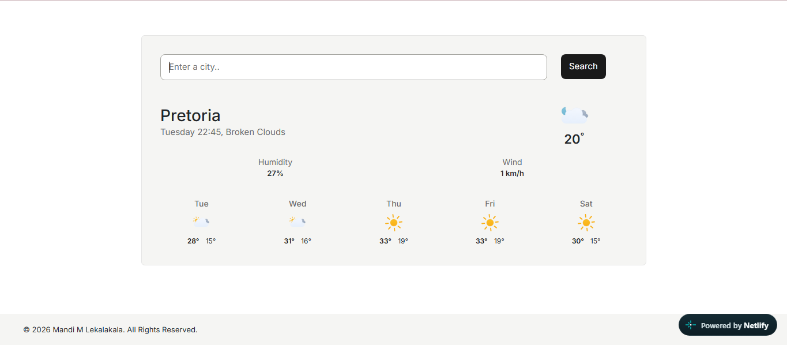

# 🌦 React Weather App

My first ever React project: a weather app where you can search any city in the world and instantly see its current conditions and a 5-day forecast.

**🔗 Live demo:** https://skycast-react-app.netlify.app/



## ✨ Features

- 🔍 Search any city
- 🌤 Current weather and description
- 🌡 Temperature in °C
- 💧 Humidity and 💨 wind speed
- 🕒 The city's own local day and time
- 📅 5-day forecast with daily highs and lows
- ⏳ Loading spinner while data is fetched
- 🎨 Animated weather icons

## 🛠 Built With

- [React](https://react.dev/) (components, props, state, `useEffect`)
- [Vite](https://vitejs.dev/)
- [Axios](https://axios-http.com/) for API requests
- [SheCodes Weather API](https://www.shecodes.io/learn/apis/weather)
- [Bootstrap](https://getbootstrap.com/) for the grid layout
- [Bootstrap Icons](https://icons.getbootstrap.com/) for the footer links
- [Meteocons](https://github.com/basmilius/weather-icons) (`@meteocons/svg`) for animated weather icons
- [tz-lookup](https://www.npmjs.com/package/tz-lookup) to find each city's time zone from its coordinates
- [React Loader Spinner](https://www.npmjs.com/package/react-loader-spinner) for the loading animation
- Custom CSS

## 🧩 Project Structure

```
src/
├── App.jsx
├── Weather.jsx
├── WeatherInfo.jsx
├── WeatherTemperature.jsx
├── WeatherIcon.jsx
├── WeatherForecast.jsx
├── WeatherForecastDay.jsx
├── FormattedDate.jsx
├── Footer.jsx
└── main.jsx
```

## 🚀 Run It Locally

```bash
git clone (https://github.com/Mandi-Lekalakala/react-weather-app).git
cd react-weather-app
npm install
npm run dev
```

## 📚 What I Learned

- Splitting an app into reusable components
- Passing data with props and updating the UI with state
- Fetching and handling API data with Axios
- Controlling side effects with `useEffect`
- Converting coordinates to local time with `tz-lookup`
- Turning a design mockup into a working UI

## 👩‍💻 Author

**Mandi Lekalakala**

- [LinkedIn](https://www.linkedin.com/in/mandilekalakala/)
- [GitHub](https://github.com/Mandi-Lekalakala)
- [Portfolio](https://mandi-lekalakala.netlify.app/)

Built with guidance from [SheCodes](https://www.shecodes.io/). 💛
